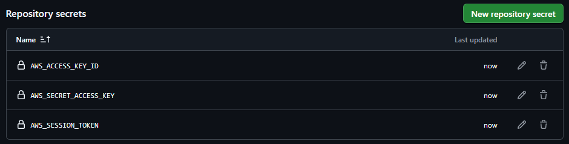

# BarrioFix

Grupo 10, Cloud Computing (82.08), ITBA

Plataforma de reparaciones barriales, migrada a una arquitectura serverless y
desplegada con Terraform.

- Frontend: React (Vite), sitio estático en S3. Repo: [barriofix-front](https://github.com/clararodriguezacevedo/barriofix-front)
- Backend: AWS Lambda (Python 3.12 + Powertools) detrás de API Gateway
- Datos: DynamoDB
- Auth: Amazon Cognito (Hosted UI)

El detalle de la arquitectura y de la infraestructura está en [docs/arquitectura.md](docs/arquitectura.md).

## Arquitectura (resumen)

El navegador carga el sitio estático desde S3 y al arrancar lee su configuración de un
`config.json`. El login y el registro pasan por la Hosted UI de Cognito, que vuelve a la
API (`/callback`), donde la Lambda `auth-callback` canjea el código por los tokens. Con
el token, el navegador llama a la API (API Gateway HTTPS, con authorizer de Cognito y
throttling), que enruta a una Lambda por dominio: catálogos, usuarios, solicitudes, flujo,
calificaciones y fotos. Esas Lambdas viven en subredes privadas sin salida a internet y
solo alcanzan DynamoDB y S3 por Gateway Endpoints. Las fotos se suben y se bajan directo a
S3 con URLs prefirmadas, sin pasar por la API. Dos funciones más corren por eventos y no
por la API: una confirma las altas de Cognito y otra registra la foto cuando termina de
subir a S3.

## Estructura

```
.
├── back/                             # backend (Python)
│   ├── functions/<dominio>/app.py    # un handler por dominio + funciones por evento
│   ├── layers/common/.../barriofix/  # layer comun (api, auth, dynamo, reglas, ...)
│   └── scripts/build.sh              # arma el layer comun
├── terraform/
│   ├── bootstrap/                    # crea el bucket del state (state local)
│   ├── modules/lambda_function/      # modulo propio (ver su README)
│   └── organization/                 # modulo raiz con toda la arquitectura
│       ├── *.tf                      # una capa por archivo (network, auth, api, ...)
│       └── seed/*.json               # catalogos (mock data)
├── docs/                             # arquitectura
└── .github/workflows/                # deploy, destroy, validate
```

## Cómo desplegar

Requisitos: credenciales de AWS, Terraform >= 1.10, Python 3.12, Node 20.

El despliegue es con GitHub Actions

1. Cargar en el repo los secrets `AWS_ACCESS_KEY_ID`, `AWS_SECRET_ACCESS_KEY` y
   `AWS_SESSION_TOKEN`
2. Mergear a main, o correr el workflow Deploy a mano. El workflow compila el front, arma
   el layer, crea el bucket del state si falta y hace `terraform apply`. El primer apply
   tarda entre 15 y 30 minutos
3. Al terminar, el resumen del run muestra la URL del sitio, de la API y del login
4. Para bajar todo, el workflow Destroy (pide escribir `destroy` para confirmar)

Usuarios de demo, creados por Terraform: `cliente.demo`, `plomero.demo` y
`electricista.demo`, con contraseña `BarrioFix-Demo-2026!`.

### Capturas del despliegue

Secrets del lab cargados en el repo:



Checks del Pull Request en verde, incluido el análisis de seguridad:


Resumen del run con las URLs del sitio, la API y el login:


## Infraestructura como código

Toda la infra se crea con Terraform.

### Módulos

- Propio: [`terraform/modules/lambda_function`](terraform/modules/lambda_function) empaqueta y
  crea cada Lambda, con su zip y su hash, su log group y, opcionalmente, VPC, concurrencia
  reservada y layers. Se instancia con `for_each` para todas las funciones de la API.
- Externo: [`terraform-aws-modules/vpc/aws`](https://registry.terraform.io/modules/terraform-aws-modules/vpc/aws)
  crea la VPC, las subredes privadas y las route tables (ver [network.tf](terraform/organization/network.tf)).
  Sobre esa red agregamos los Gateway Endpoints y el security group.

### Funciones

`cidrsubnet` para las subredes, `jsonencode` para las policies y el `config.json`, `jsondecode`
y `file` para leer el seed de catálogos, `merge` para los tags y los ítems del seed, `format`
para los nombres con el account id, `lookup` para el content-type según la extensión de cada
archivo del front, `filemd5` para subir a S3 solo lo que cambió, y `try` para los campos
opcionales del seed.

### Meta-argumentos

`for_each` en las Lambdas, las rutas, el seed y los archivos del front. `count` en la resource
policy opcional de DynamoDB. `depends_on` para crear el log group antes de la función y la
notificación de S3 después del permiso. `lifecycle` con `create_before_destroy` en los layers.

### State

El state es remoto, en un bucket de S3 cuyo nombre lleva el account id, con lock por
`use_lockfile`. El bucket lo crea un bootstrap aparte ([terraform/bootstrap](terraform/bootstrap))
que usa state local, porque el backend remoto no puede crear el bucket que todavía no existe. El
bootstrap se corre una vez por cuenta, después todos los apply del módulo principal usan ese
state remoto. El nombre del bucket se pasa al `terraform init` por `backend-config`, así nada de
la cuenta queda hardcodeado, y el workflow de deploy usa un grupo de concurrencia para que no se
superpongan dos apply sobre el mismo state.

El despliegue es reproducible en cualquier cuenta: el account id sale de un data source y los
nombres de bucket llevan el sufijo de cuenta, de modo que se despliega en una cuenta nueva con
un solo pipeline.
