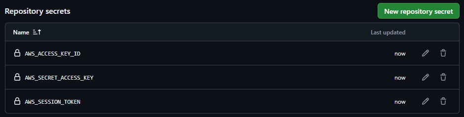
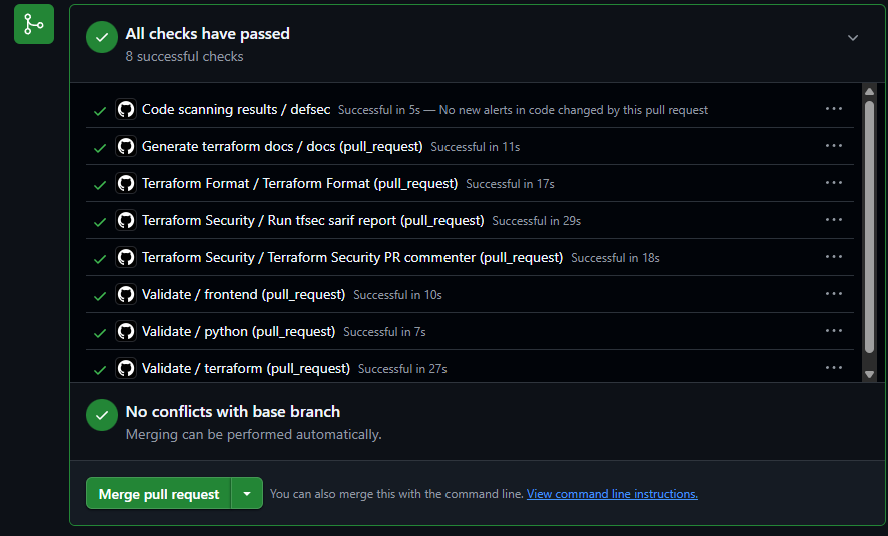
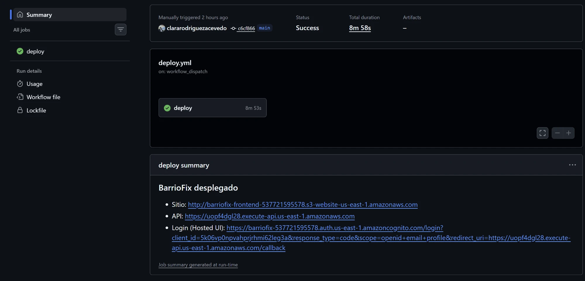

# BarrioFix

Grupo 10, Cloud Computing (82.08), ITBA.

BarrioFix es una plataforma para pedir reparaciones en el barrio. Un cliente publica una
solicitud, un profesional de esa categoría la toma y la resuelve, y después recibe una
calificación. La app corre sobre una arquitectura serverless en AWS y se despliega entera con
Terraform.

El frontend es una app de React que se sirve como sitio estático desde S3 y vive en otro
repo, [barriofix-front](https://github.com/clararodriguezacevedo/barriofix-front). Este repo
tiene el backend, la infraestructura en Terraform y los workflows de GitHub Actions. Cómo se
conectan las piezas está en [docs/arquitectura.md](docs/arquitectura.md), y los detalles de
Terraform en [docs/terraform.md](docs/terraform.md).

## Organización del repo

```
back/functions/          un handler por Lambda
back/layers/common/      código compartido entre las Lambdas (layer)
back/scripts/            build del layer y generador del histórico de demo
back/tests/              tests de la lógica sin AWS
terraform/bootstrap/     crea el bucket del state
terraform/modules/       nuestro módulo lambda_function
terraform/organization/  la arquitectura completa, un archivo por capa
docs/                    arquitectura, Terraform y capturas
.github/workflows/       deploy, destroy y los checks del PR
```

En terraform/organization/seed están los JSON con la mock data, y en terraform/organization/sql
las consultas de negocio que se guardan en Athena.

## Cómo desplegar

Hace falta una cuenta de AWS (usamos el Learner Lab). Todo el despliegue corre en GitHub
Actions.

1. Cargar como secrets del repo AWS_ACCESS_KEY_ID, AWS_SECRET_ACCESS_KEY y AWS_SESSION_TOKEN,
   que salen de AWS Details en el lab. La key de Google Maps no hace falta, ya viene como default
   de la variable google_maps_api_key. Es pública a propósito porque el navegador la recibe igual.
   Para usar otra, se carga como secret GOOGLE_MAPS_API_KEY.

   

   Opcional, para que los mails salgan de verdad: SMTP_HOST, SMTP_USER, SMTP_PASSWORD y SMTP_FROM
   (y SMTP_PORT si no es 587), por ejemplo con el sandbox de Mailtrap. Sin esos secrets la app
   funciona igual y los envíos quedan en el log.

2. Abrir un pull request. Ahí corren los checks que no necesitan credenciales (formato,
   terraform validate, tfsec, tests de Python y build del front).

   

3. Mergear a main, o correr el workflow Deploy a mano. El workflow compila el front, arma el
   layer, crea el bucket del state si todavía no existe y después hace init, validate, plan y
   apply con el plan guardado. La primera vez tarda bastante, porque aplica de a un recurso
   por el límite de interfaces de red del lab.

4. Cuando termina, el resumen del run tiene la URL del sitio, la de la API y la del login.

   

Para eliminar todo está el workflow Destroy, que pide escribir "destroy" para confirmar.

Terraform crea diez usuarios de demo, todos con la contraseña BarrioFix-Demo-2026!. Los
clientes son juan.perez, sofia.garcia, martin.lopez, valentina.romero y lucas.fernandez, y los
profesionales son carlos.electricista, diego.plomero, mariano.gasista, pablo.pintor y
federico.tecnico, cada uno con sus categorías y zonas.

## Eventos y analytics

Cada cambio de una solicitud genera un evento a partir de DynamoDB Streams, que llega por SNS a
tres consumidores. Uno guarda los eventos en S3 para consultarlos con Athena, otro avisa por mail
a la otra parte de cada cambio y el tercero avisa a los profesionales de la zona cuando aparece
un trabajo. El detalle está en [docs/arquitectura.md](docs/arquitectura.md).

Para ver las métricas de negocio, en la consola de Athena se elige el workgroup
barriofix-analytics y se corre cualquiera de las Saved queries. Ya hay datos desde el primer
deploy, porque la mock data incluye un histórico de 80 solicitudes.

## State

El state está en un bucket de S3 con el account id en el nombre y usa use_lockfile para el lock.
Ese bucket lo crea un bootstrap aparte, porque Terraform no puede crear el bucket que usa como
backend. El nombre se pasa en el init con -backend-config, así nada de la cuenta queda en el
código y el mismo pipeline despliega en cualquier cuenta.
